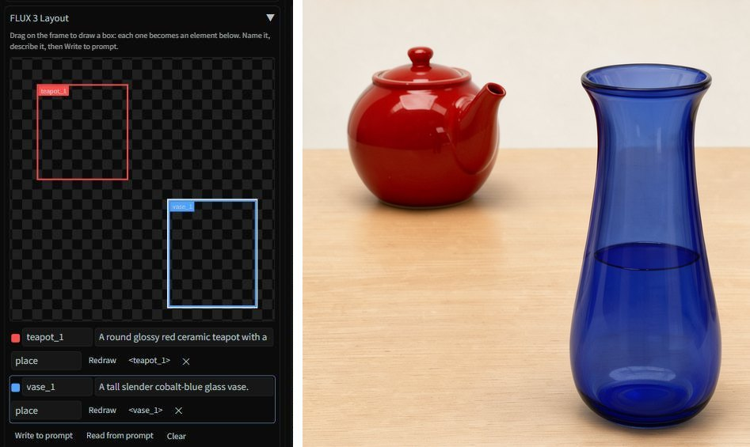
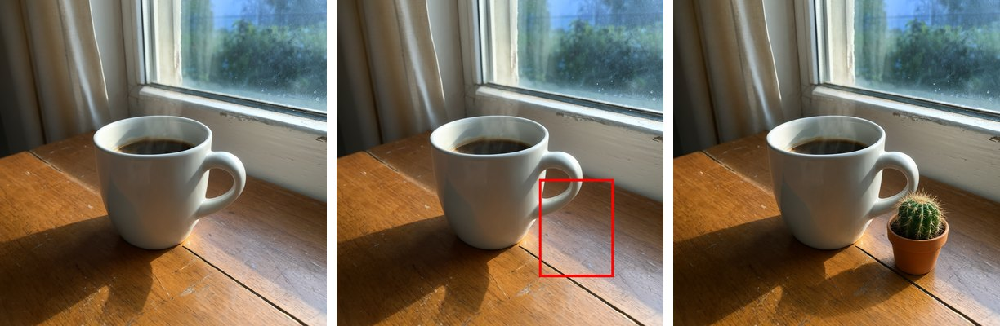
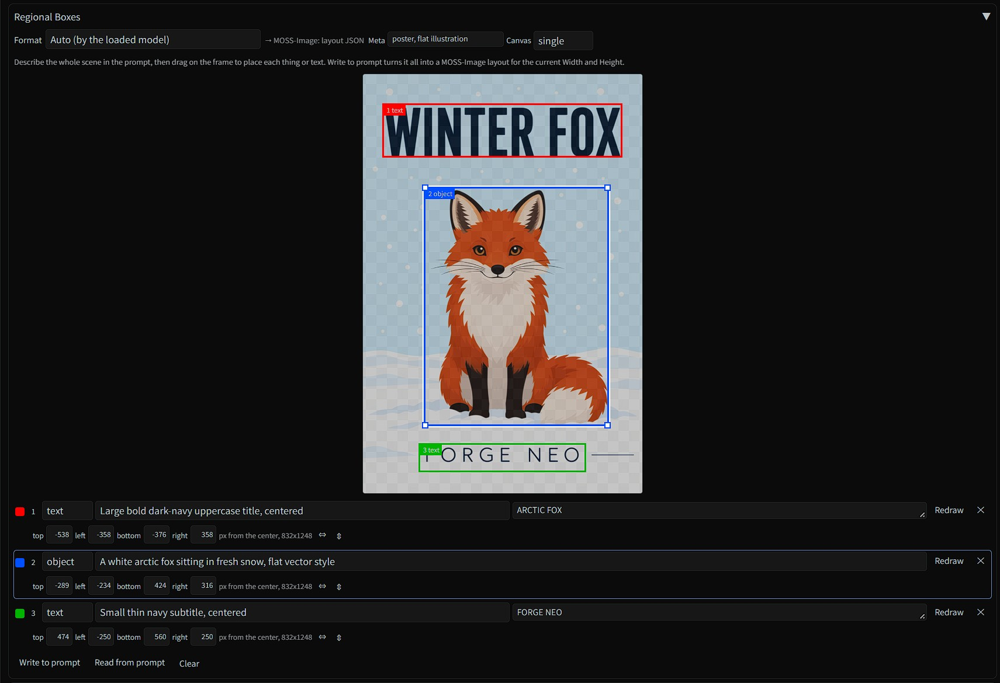
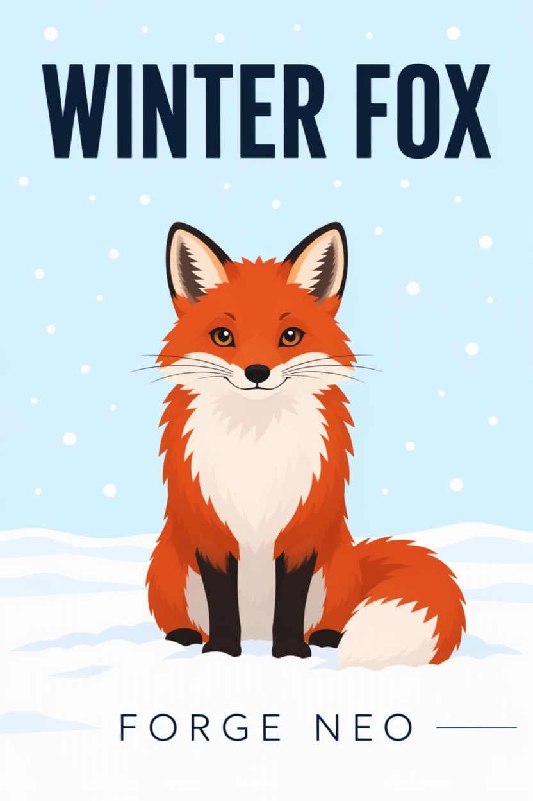
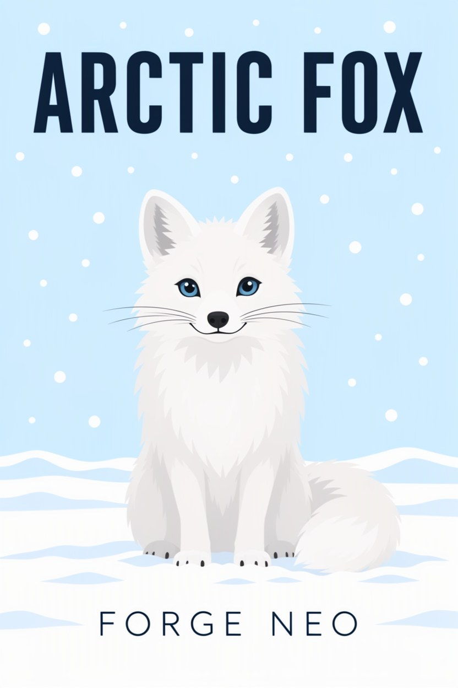
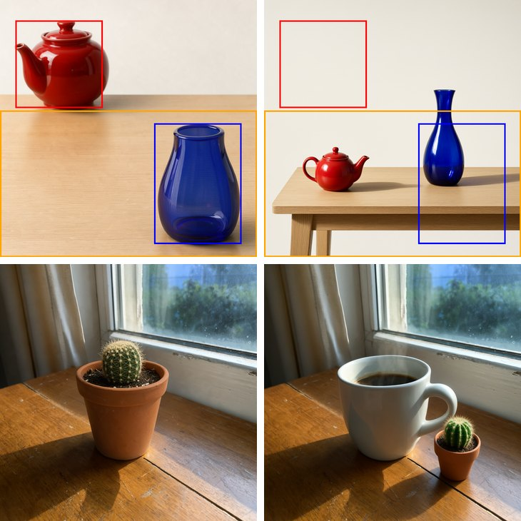

# 🔲 Regional Boxes for Forge Neo

> **Extension for [Stable Diffusion WebUI Forge - Neo](https://github.com/Haoming02/sd-webui-forge-classic/tree/neo)**

Draw boxes with the mouse to tell **FLUX 3 Image Klein**, **Qwen-Image 2.1** or **MOSS-Image** where things go - the panel hands them to each model in the format it was trained on: **coordinates in the prompt** for FLUX 3, **boxes drawn on the picture** for Qwen-Image 2.1, a **layout prompt** for MOSS-Image. No coordinates to type, no image editor needed.

> [!Important]
> This extension requires an up-to-date **Forge Neo** (the `neo` branch). It only writes the prompt and, for Qwen-style edits, draws the boxes on the input picture - nothing of Forge Neo is changed.

---

## 📋 Table of Contents

- [What's New](#-whats-new)
- [Features](#-features)
- [Which Models](#-which-models)
- [Installation](#-installation)
- [How to Use](#%EF%B8%8F-how-to-use)
- [Tips](#-tips)
- [Credits](#-credits)

---

## 🆕 What's New

### v0.2.4 - Scene and Extra

- **Scene** - with MOSS-Image, the whole picture is described in the panel, and becomes the layout's caption; it stays there when you clear the prompt, and a scene typed as the prompt still fills it
- **Extra** - LoRA tags and their trigger words, written after the layout, outside it; a LoRA you add from Forge Neo's LoRA tab after writing is kept too
- Both follow the prompt: **Read from prompt** fills them, and a caption or tag changed by hand in the prompt shows up in them

### v0.2.3 - Last Picture and Dynamic Prompts

- **The last picture behind the boxes** in txt2img - the one the gallery shows, so you can place the next boxes over what came out; **Show the last picture behind the boxes** turns it off
- **A warning while sd-dynamic-prompts is on**, with FLUX 3 and MOSS-Image - it removes the layout's `{ }` before the model reads it
- **Read from prompt reads a layout that lost its braces** - from a prompt Forge saved, or pasted from PNG Info - and **Write to prompt** puts them back
- Words after a MOSS-Image layout, such as a LoRA's trigger word, are kept after it and no longer stop **Read from prompt**
- Reads the layouts of Forge Neo's own **JSON Builder**, also with parentheses in their captions
- With MOSS-Image, **Write to prompt** on a cleared prompt reuses the scene of the last layout, and says so; the warning asking for a scene stays until you edit the prompt

### v0.2.2 - Move and Resize Boxes

- **Drag a box by its name tag** to move it, and by the corners of the selected box to resize it - with every format
- Dragging anywhere else still draws a new box, also inside another one
- **⇔ and ⇕** center a box across or down the picture, keeping its size
- With MOSS-Image, a warning when the boxes in the panel are no longer the ones written in the prompt

### v0.2.1 - Layouts Follow the Picture Size

- **MOSS-Image layouts follow the size** - change **Width** and **Height**, or switch img2img to **Resize by**, and the boxes in the prompt move to fit the new size on their own
- In img2img, the size is the one Forge Neo will really use, also with **Resize by**

### v0.2.0 - MOSS-Image

- **Layout prompts** for MOSS-Image - draw boxes for things and for text, and the panel writes the whole prompt as MOSS-Image's layout
- **Each box's position in pixels**, under its row - type a number to move an edge exactly where you want it
- **Read from prompt** loads a MOSS-Image layout back into the panel, to adjust it
- A warning when **Width** or **Height** changes after the layout was written
- The frame keeps the shape of tall pictures

### v0.1.0 - First Release

- **Regional Boxes panel** in txt2img and img2img - draw, name and describe boxes on a frame shaped like your picture.
- **Coordinates** for FLUX 3 Image Klein - layouts and box edits, written into the prompt.
- **Marks on the image** for Qwen-Image 2.1 - the boxes are drawn on the input picture when you generate, with a note per box in the prompt.
- **Auto** format - picks the right one for the loaded model, FLUX 3 or Qwen-Image 2.1.

---

## 🎯 Features

### 📐 Coordinates (FLUX 3 Image Klein)

- Each box becomes an element of the JSON list FLUX 3 reads at the end of the prompt, in [Black Forest Labs' format](https://docs.bfl.ai/flux_3/flux3_image_bounding_boxes)
- **place** things in a new picture, or edit one: **add new**, take it **from reference** (where it is, then where it goes) or **remove** it
- The **`<name>`** button puts each box's tag at the cursor in your caption; **Read from prompt** loads a list back to adjust it
- Needs the [FLUX 3 Image Klein extension](https://github.com/eduardoabreu81/flux3-image-forge-neo)

### 🖍️ Marks on the Image (Qwen-Image 2.1)

- Draw over the img2img picture and say what to do inside each box: *add a cactus*, *change the shirt to denim*, *remove it*
- **Write to prompt** adds one note per box - *"Inside the red box: ..."* - and asks the model to remove the outlines
- When you generate, the boxes are drawn on a copy of the input picture in their colors - only with Qwen-Image 2.1 loaded; your file is not touched
- Works with Forge Neo's own Qwen-Image 2.1 support and with the [Qwen-Image 2.1 extension](https://github.com/eduardoabreu81/qwen2.1-forge-neo)
- Up to 8 boxes, each in its own named color (red, blue, green, yellow, magenta, orange, cyan, purple)

### 🧩 Layout Prompts (MOSS-Image)

- Describe the whole picture in **Scene** (or as the prompt), then draw a box for each thing and each piece of text
- For each box, choose what it holds - **object**, **character** or **text** - and say how it looks; a text box also takes the exact words to write, with Enter for a new line
- **Meta** says what kind of picture it is (*poster, flat illustration*, *product photo*...), and **Canvas** whether it is one picture, panels or a collage
- **Write to prompt** turns it all into [MOSS-Image's layout](https://github.com/OpenMOSS/MOSS-Image/blob/main/USERGUIDE.md#layout-prompts-experimental), the way OpenMOSS's own tools write it; Scene becomes the layout's caption
- Under each box, its edges in pixels from the center of the picture, as the layout uses them - type a number to set an edge exactly
- **Read from prompt** loads a layout back, yours or one you pasted, to adjust it
- **Extra** holds LoRA tags such as `<lora:name:1>` and their trigger words: they go after the layout, where Forge Neo still finds them, and tags already in the prompt are kept
- Change the size and the layout follows: the boxes in the prompt are moved to fit, and the panel says so
- In img2img, draw over the input picture and describe the new version: things keep their place, while captions and words can change
- Works in txt2img and img2img; needs the [MOSS-Image extension](https://github.com/eduardoabreu81/moss-image-forge-neo) 0.1.2 or newer, which keeps the layout whole with sd-dynamic-prompts installed

 

txt2img, then the same boxes in img2img with a new title and an arctic fox - 8-step LoRA, RTX 2070

### 🛡️ Safe by Design

- Changes no Forge Neo file and adds no generation setting of its own
- Works with **sd-dynamic-prompts** installed, and warns while it is on, since it breaks layouts
- The infotext records which boxes were drawn

---

## 🤖 Which Models

Regional Boxes works with three models, each in the format it was trained on. Tested on an 8 GB RTX 2070:

| Model | Format | |
| :--- | :--- | :--- |
| **FLUX 3 Image Klein** | Coordinates in the prompt | ✅ top left: things land in their boxes |
| **Qwen-Image 2.1** | Marks on the picture | ✅ bottom right: the cactus in the box, the outline gone |
| **MOSS-Image** | Layout prompt | ✅ the poster above: title, fox and subtitle in their boxes |

FLUX 3 and Qwen-Image 2.1 do not follow each other's format (top right, bottom left), so **Auto** picks the format by the loaded model. With any other model the panel says so and writes nothing. For SD 1.5, SDXL, Anima, Z-Image and Krea 2, region tools that steer the model's attention work instead: [Forge Couple](https://github.com/Haoming02/sd-forge-couple) and [Regional Prompter](https://github.com/hako-mikan/sd-webui-regional-prompter).

---

## 📦 Installation

1. Open Forge Neo WebUI
2. Go to **Extensions** → **Install from URL**
3. Paste: `https://github.com/eduardoabreu81/sd-regional-boxes-neo`
4. Click **Install** and restart the WebUI

---

## 🖱️ How to Use

1. Load FLUX 3 Image Klein, Qwen-Image 2.1 or MOSS-Image, and open **Regional Boxes** in txt2img or img2img - the format follows the loaded model, or pick it yourself
2. Set **Width** and **Height** first, then drag on the frame to draw a box; in img2img the input picture shows behind it, and in txt2img the last picture you made (turn it off with **Show the last picture behind the boxes**)
3. Describe each box - what it is (coordinates, layout) or what to do inside it (marks)
4. Click **Write to prompt**, then **Generate**

For edits, use img2img with **Denoising strength** 1 and the model's reference option on (**[Qwen 2.1] Enable Reference**, **[Klein] Enable Reference**).

---

## 💡 Tips

- Boxes guide placement and size; they are not a mask, and the model may draw a little past them
- Marks work best with a box drawn a bit larger than the thing to change
- Drag a box by its name tag to move it, and by the corners of the selected box to resize it; dragging anywhere else draws a new box, even inside another one
- **⇔** and **⇕** center a box across or down the picture, keeping its size
- Click a box without dragging to select it; **Redraw** draws it again; ✕ deletes it
- Writing again replaces the boxes already in the prompt, so draw, adjust and write as often as you like
- The frame takes the shape of your **Width** and **Height**
- MOSS-Image layouts are in pixels of the picture's size, so a new size moves the boxes in the prompt with it; if you changed the boxes' numbers by hand in the prompt, they are left as they are and the panel asks you to **Write to prompt** again
- With MOSS-Image, write the scene description in English for the best results, and give text boxes room for their words
- Turn off **Dynamic Prompts enabled** (sd-dynamic-prompts) when you use FLUX 3 or MOSS-Image layouts: it removes the layout's `{ }` before the model reads it, and the boxes are lost. The panel warns you while it is on; **Read from prompt** still reads a layout that lost its braces, and **Write to prompt** puts them back

---

## 📄 Credits

- **[Forge Neo](https://github.com/Haoming02/sd-webui-forge-classic/tree/neo)** by Haoming02
- **[FLUX 3 Image Klein](https://huggingface.co/black-forest-labs/flux-3-image-klein)** by Black Forest Labs - the bounding box format, and the mug photo of the examples
- **[Qwen-Image 2.1](https://huggingface.co/Qwen)** by the Qwen team - edits guided by marks on the picture
- **[MOSS-Image](https://github.com/OpenMOSS/MOSS-Image)** by OpenMOSS - the layout prompt format

---

## 📜 License

AGPL-3.0 - see [LICENSE](LICENSE)

---

Made with ❤️ for the Stable Diffusion community

**[Report Bug](https://github.com/eduardoabreu81/sd-regional-boxes-neo/issues)** • **[Request Feature](https://github.com/eduardoabreu81/sd-regional-boxes-neo/issues)** • **[☕ Ko-fi](https://ko-fi.com/eduardoabreu81)**

