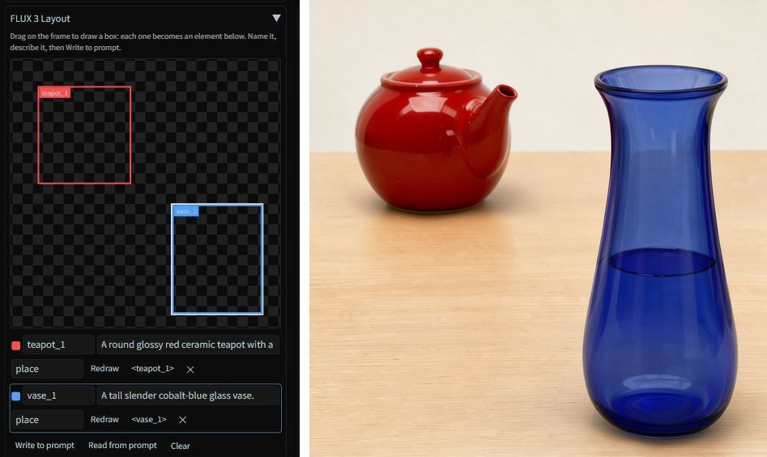
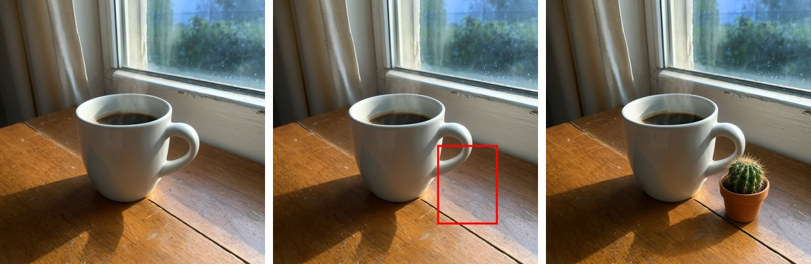
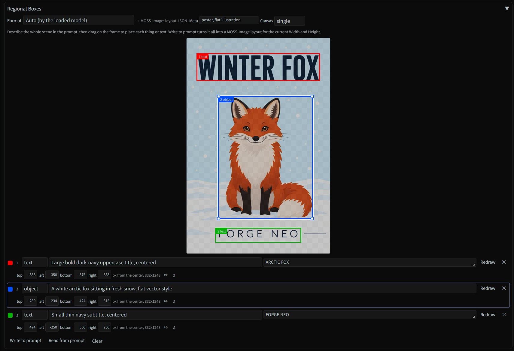
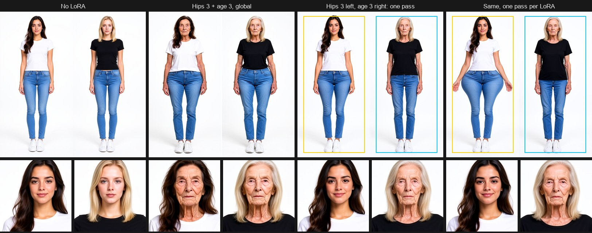
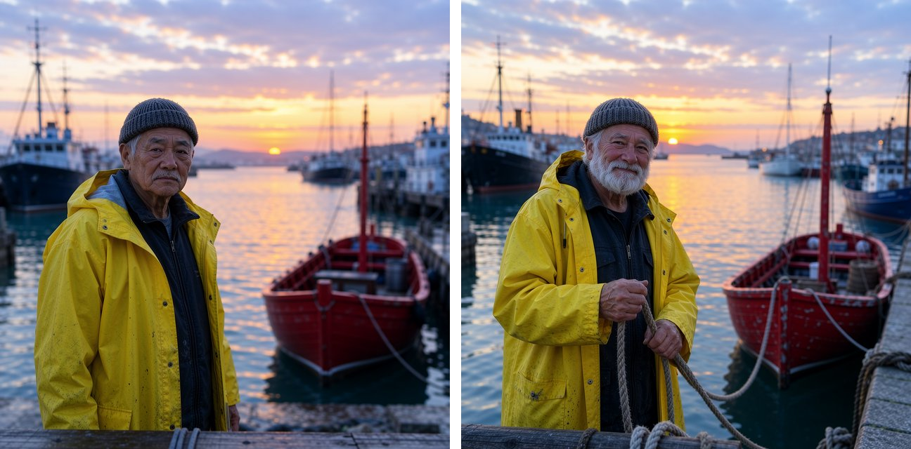
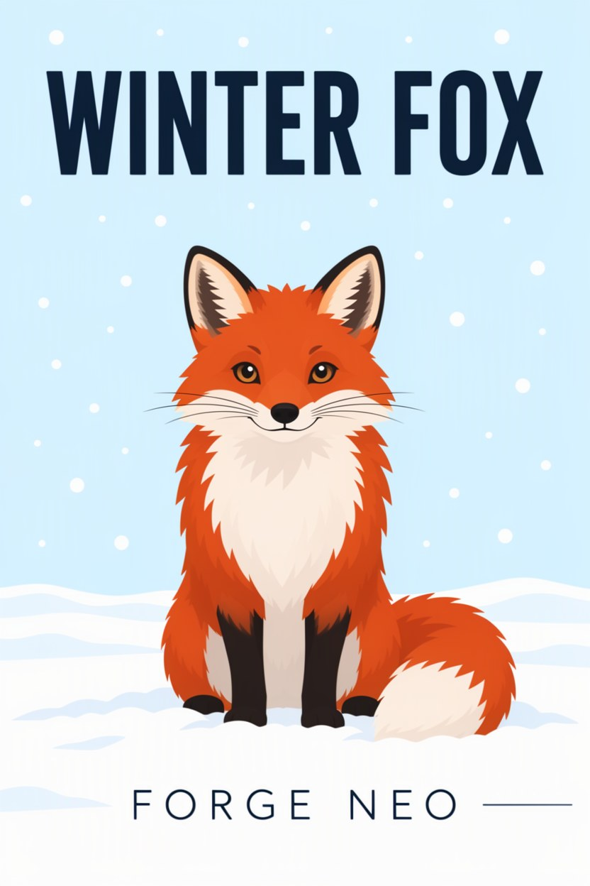
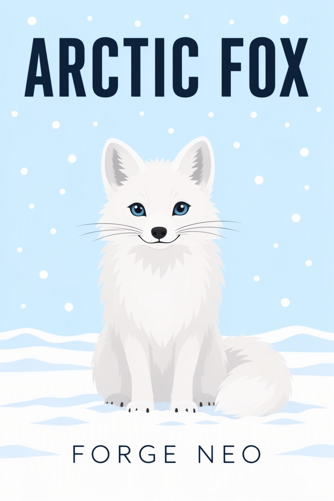
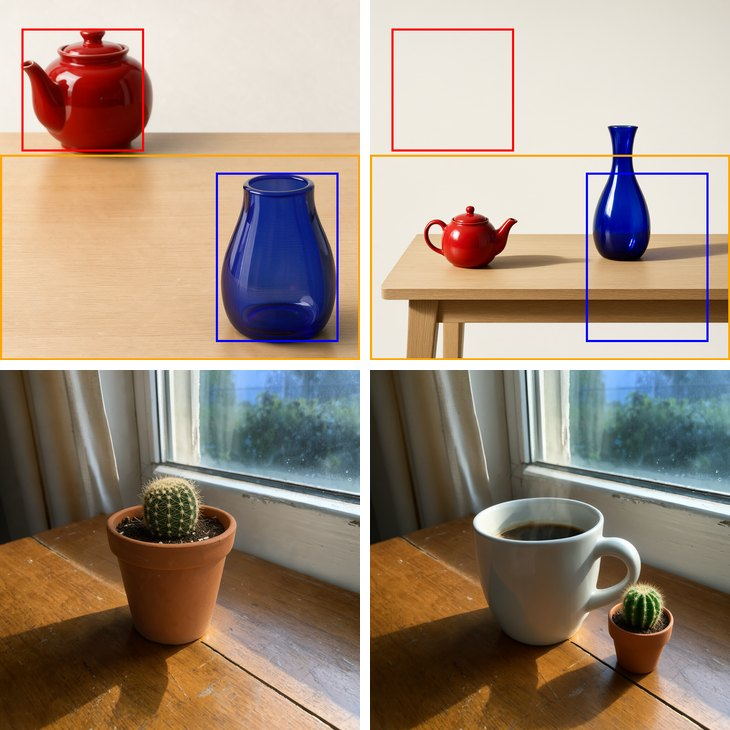

# 🔲 Regional Boxes for Forge Neo

> **Extension for [Stable Diffusion WebUI Forge - Neo](https://github.com/Haoming02/sd-webui-forge-classic/tree/neo)**

Draw boxes with the mouse, or a finger on a touch screen, to tell **FLUX 3 Image Klein**, **Qwen-Image 2.1** or **MOSS-Image** where things go - the panel hands them to each model in the format it was trained on: **coordinates in the prompt** for FLUX 3, **boxes drawn on the picture** for Qwen-Image 2.1, a **layout prompt** for MOSS-Image. No coordinates to type, no image editor needed.

For the **PAN 2** video model, the panel becomes a **timeline of the clip**: lay out what happens, the camera moves and what each subject does, and it writes PAN 2's structured description for you.

> [!Important]
> This extension requires an up-to-date **Forge Neo** (the `neo` branch). It only writes the prompt and, for Qwen-style edits, draws the boxes on the input picture - nothing of Forge Neo is changed.

---

## 📋 Table of Contents

- [What's New](#-whats-new)
- [Features](#-features)
- [Which Models](#-which-models)
- [Installation](#-installation)
- [How to Use](#%EF%B8%8F-how-to-use)
- [Tips](#-tips)
- [Credits](#-credits)

---

## 🆕 What's New

### v0.5.0 - Full Screen, Zoom, Snap and Tags per Box

- **⛶ Full screen** - the same panel over the whole window: the frame as big as the screen lets it be, the boxes' rows beside it, **Write to prompt** at the top; Esc or ✕ brings it back to its place, with the boxes, undo and the fields as they were. On a phone the frame stays on top while the rows scroll under it, and the Back button closes it
- **Zoom** - Ctrl + wheel (or a trackpad's pinch), two fingers on a touch screen, or **− 100% +** on the frame; in full screen the wheel alone zooms. Move around with the middle button, Space + drag, two fingers, or the wheel on a zoomed frame. Boxes drawn while zoomed land where you drew them
- **Snap** - while a box is drawn, moved or resized, its edges and middle snap to the picture's edges and middle, the guides and the other boxes, with a line to show it; hold **Alt** to place it freely, or turn **Snap** off
- **Tags** for each MOSS-Image box - keywords the model follows closely (the item's `tags`), next to its description: on the same seed, tags gave the fisherman a white beard, a smile and a rope, and the boat peeling paint ([picture](#-layout-prompts-moss-image))
- **Read from prompt keeps what the panel has no field for** - a palette on a box or on the scene, and any other field, as [MOSS Layout](https://github.com/SillySilk/sd-forge-moss-layout) writes them: Read then Write no longer drops them
- **No Dynamic Prompts warning with MOSS-Image** when the MOSS-Image extension 0.1.8 or newer is installed, since it puts the layout's `{ }` back; without it the warning says to install it or turn Dynamic Prompts off

### v0.4.1 - LoRAs Kept in Their Boxes

- **A LoRA in a box acts only inside it** with the [MOSS-Image extension](https://github.com/eduardoabreu81/moss-image-forge-neo) 0.1.8 or newer - on its own backend and on Forge Neo's built-in MOSS-Image, also with sd-dynamic-prompts on
- Tested on an RTX 2070: a hips slider in one woman's box and an age slider in the other's change only that woman each, and an anime LoRA in one box with a realism LoRA in the other give an anime woman next to a photographed one ([picture](#-layout-prompts-moss-image))
- The **+ LoRA** button says whether the LoRA will stay in its box or act on the whole picture

### v0.4.0 - LoRAs per Box, Picture Strength and W×H

- **+ LoRA** next to each MOSS-Image box, and next to the Additional prompt (MOSS-Image and PAN 2): a list of the LoRAs of Forge's Lora tab, with their previews, to search by name or folder; a pick adds the LoRA with the weight and trigger words its card sets, a second pick takes it out
- **A LoRA in a box's description stays in that box's caption** in the layout. With [MOSS Regional LoRA](https://github.com/Haoming02/sd-webui-forge-classic/discussions/1645) (from SillySilk's Forge Neo fork) it acts only inside the box; without it, Forge applies it to the whole picture, as any LoRA in the prompt
- **Picture** - how strong the picture behind the boxes is, from faint to full; kept for the next time
- **⇅ W×H** swaps Width and Height: portrait to landscape and back, with the frame and the layout following
- **The selected box comes to the front**, with its tag and handles over the boxes it overlaps
- **Change a box's type on the frame** - a click on the label at the bottom of the selected box takes the next: object, character, text with MOSS-Image; place, add new, from reference, remove with FLUX 3

### v0.3.1 - PAN 2 Timeline Fixes

- **Tested with PAN 2** - a five-second clip built on the timeline in Forge Neo, from the panel to the MP4
- **Dark fields** - the PAN 2 fields follow Forge's dark theme instead of white boxes with light text, and the examples in empty fields are faded and in italics, so they no longer look filled in
- **The timeline appears by itself** when you pick the **pan2** preset or a PAN 2 checkpoint, at the length that preset's Frames sets (it used to need a click in the panel, and could keep the previous preset's length)
- **A drag ends when you let go**, even where the browser loses the release: a line between events no longer follows the next move of the mouse
- **Quality** is listed under "Before you generate" when it is empty, like the other fields

### v0.3.0 - PAN 2 Timeline, Undo and Shortcuts

- **PAN 2 format** - a timeline of the clip instead of the frame: events, camera moves and each subject's actions, written as [PAN 2](https://huggingface.co/IFM/PAN2)'s structured description for the [PAN 2 extension](https://github.com/eduardoabreu81/pan2-forge-neo) ; **Auto** picks it with the **pan2** preset or a PAN 2 checkpoint
- **Undo and Redo** for the boxes - ↶ and ↷, or Ctrl+Z and Ctrl+Y; a description typed in one go, or a box nudged several times, undoes as one step
- **Side handles** on the selected box, and **Shift** keeps its shape while you resize it
- **⧉ Duplicate** a box, or Ctrl+D - the copy lands a little below and to the right, with its own color
- **Keys** - Delete removes the selected box, Esc lets it go, the arrow keys move it (Shift for bigger steps), and a double-click jumps to its description
- **Guides** over the frame - rule of thirds, center or golden ratio, kept for the next time

### v0.2.7 - Additional Prompt and Fixes

- MOSS-Image's **Extra** field is now **Additional prompt**: it takes LoRA tags, trigger words or any other words, after the layout
- A LoRA written in a box's description is no longer copied after the layout again on every **Write to prompt**; a prompt left with copies comes back clean on the next one
- Marks keep one box per color: the panel draws no 9th box, and a box that shares a color with another (from another format, or read from a prompt) is left out of the notes, with a warning

### v0.2.6 - Touch Screens

- **Draw, move and resize boxes with a finger** - on a phone, a tablet or a touch screen, the frame works as it does with the mouse; a drag on it no longer scrolls or zooms the page (thanks to [1243a-alt](https://github.com/1243a-alt))
- A touch the system takes away in the middle of a drag, such as a gesture or a notification, puts the box back where it was instead of leaving it stuck to the finger
- A second finger on the frame is ignored while the first one draws or moves a box

### v0.2.5 - Styles, Box Tags, Hide the Boxes and Autocomplete

- **Styles go into the layout's caption** - with a MOSS-Image layout as the prompt, the Styles you pick no longer land after the layout, outside it: their words are added to the scene caption, the way Forge Neo would apply them to a plain prompt, also a style with `{prompt}`
- **Box tags say what each box holds** - with MOSS-Image, a box on the frame is tagged with its words or the start of its description, *1 WINTER FOX*, *2 a red fox sitting…*, instead of only *1 text*, *2 character*; only the panel shows it, the layout is the same
- **Hide the boxes** - see the picture behind them whole, at full strength, and turn them back on to keep drawing
- **Tag Autocomplete in the panel** - Scene, Additional prompt and each box's description complete tags, LoRAs and wildcards as the prompt does, with [Tag Autocomplete](https://github.com/DominikDoom/a1111-sd-webui-tagcomplete) installed

### v0.2.4 - Scene and Extra

- **Scene** - with MOSS-Image, the whole picture is described in the panel, and becomes the layout's caption; it stays there when you clear the prompt, and a scene typed as the prompt still fills it
- **Extra** - LoRA tags and their trigger words, written after the layout, outside it; a LoRA you add from Forge Neo's LoRA tab after writing is kept too
- Both follow the prompt: **Read from prompt** fills them, and a caption or tag changed by hand in the prompt shows up in them

### v0.2.3 - Last Picture and Dynamic Prompts

- **The last picture behind the boxes** in txt2img - the one the gallery shows, so you can place the next boxes over what came out; **Show the last picture behind the boxes** turns it off
- **A warning while sd-dynamic-prompts is on**, with FLUX 3 and MOSS-Image - it removes the layout's `{ }` before the model reads it
- **Read from prompt reads a layout that lost its braces** - from a prompt Forge saved, or pasted from PNG Info - and **Write to prompt** puts them back
- Words after a MOSS-Image layout, such as a LoRA's trigger word, are kept after it and no longer stop **Read from prompt**
- Reads the layouts of Forge Neo's own **JSON Builder**, also with parentheses in their captions
- With MOSS-Image, **Write to prompt** on a cleared prompt reuses the scene of the last layout, and says so; the warning asking for a scene stays until you edit the prompt

### v0.2.2 - Move and Resize Boxes

- **Drag a box by its name tag** to move it, and by the corners of the selected box to resize it - with every format
- Dragging anywhere else still draws a new box, also inside another one
- **⇔ and ⇕** center a box across or down the picture, keeping its size
- With MOSS-Image, a warning when the boxes in the panel are no longer the ones written in the prompt

### v0.2.1 - Layouts Follow the Picture Size

- **MOSS-Image layouts follow the size** - change **Width** and **Height**, or switch img2img to **Resize by**, and the boxes in the prompt move to fit the new size on their own
- In img2img, the size is the one Forge Neo will really use, also with **Resize by**

### v0.2.0 - MOSS-Image

- **Layout prompts** for MOSS-Image - draw boxes for things and for text, and the panel writes the whole prompt as MOSS-Image's layout
- **Each box's position in pixels**, under its row - type a number to move an edge exactly where you want it
- **Read from prompt** loads a MOSS-Image layout back into the panel, to adjust it
- A warning when **Width** or **Height** changes after the layout was written
- The frame keeps the shape of tall pictures

### v0.1.0 - First Release

- **Regional Boxes panel** in txt2img and img2img - draw, name and describe boxes on a frame shaped like your picture.
- **Coordinates** for FLUX 3 Image Klein - layouts and box edits, written into the prompt.
- **Marks on the image** for Qwen-Image 2.1 - the boxes are drawn on the input picture when you generate, with a note per box in the prompt.
- **Auto** format - picks the right one for the loaded model, FLUX 3 or Qwen-Image 2.1.

---

## 🎯 Features

### 📐 Coordinates (FLUX 3 Image Klein)

- Each box becomes an element of the JSON list FLUX 3 reads at the end of the prompt, in [Black Forest Labs' format](https://docs.bfl.ai/flux_3/flux3_image_bounding_boxes)
- **place** things in a new picture, or edit one: **add new**, take it **from reference** (where it is, then where it goes) or **remove** it
- The **`<name>`** button puts each box's tag at the cursor in your caption; **Read from prompt** loads a list back to adjust it
- Needs the [FLUX 3 Image Klein extension](https://github.com/eduardoabreu81/flux3-image-forge-neo)

### 🖍️ Marks on the Image (Qwen-Image 2.1)

- Draw over the img2img picture and say what to do inside each box: *add a cactus*, *change the shirt to denim*, *remove it*
- **Write to prompt** adds one note per box - *"Inside the red box: ..."* - and asks the model to remove the outlines
- When you generate, the boxes are drawn on a copy of the input picture in their colors - only with Qwen-Image 2.1 loaded; your file is not touched
- Works with Forge Neo's own Qwen-Image 2.1 support and with the [Qwen-Image 2.1 extension](https://github.com/eduardoabreu81/qwen2.1-forge-neo)
- Up to 8 boxes, each in its own named color (red, blue, green, yellow, magenta, orange, cyan, purple)

### 🧩 Layout Prompts (MOSS-Image)

- Describe the whole picture in **Scene** (or as the prompt), then draw a box for each thing and each piece of text
- For each box, choose what it holds - **object**, **character** or **text** - and say how it looks; a text box also takes the exact words to write, with Enter for a new line
- **Tags** add keywords to a box (*red scarf, smiling*), separated by commas - optional; MOSS-Image follows them closely
- Fields the panel does not edit, such as a palette from [MOSS Layout](https://github.com/SillySilk/sd-forge-moss-layout), are kept through **Read from prompt** and **Write to prompt**
- **Meta** says what kind of picture it is (*poster, flat illustration*, *product photo*...), and **Canvas** whether it is one picture, panels or a collage
- **Write to prompt** turns it all into [MOSS-Image's layout](https://github.com/OpenMOSS/MOSS-Image/blob/main/USERGUIDE.md#layout-prompts-experimental), the way OpenMOSS's own tools write it; Scene becomes the layout's caption
- Under each box, its edges in pixels from the center of the picture, as the layout uses them - type a number to set an edge exactly
- **Read from prompt** loads a layout back, yours or one you pasted, to adjust it
- **Additional prompt** holds what goes outside the layout - LoRA tags such as `<lora:name:1>`, their trigger words, any other words: they go after the layout, where Forge Neo still finds them, and tags already in the prompt are kept
- **+ LoRA** picks a LoRA from Forge's Lora tab, with its weight and trigger words: next to the Additional prompt for the whole picture, next to a box for that box's caption. A LoRA in a box acts only inside it with the [MOSS-Image extension](https://github.com/eduardoabreu81/moss-image-forge-neo) 0.1.8 or newer (or SillySilk's [MOSS Regional LoRA](https://github.com/Haoming02/sd-webui-forge-classic/discussions/1645)); otherwise Forge applies it to the whole picture
- **Styles** picked under Generate go into the scene caption when you generate, not after the layout, also with sd-dynamic-prompts on; their negative part goes to the negative prompt as usual, and the infotext names them under *Regional boxes styles*
- Change the size and the layout follows: the boxes in the prompt are moved to fit, and the panel says so
- In img2img, draw over the input picture and describe the new version: things keep their place, while captions and words can change
- Works in txt2img and img2img; needs the [MOSS-Image extension](https://github.com/eduardoabreu81/moss-image-forge-neo) 0.1.2 or newer, which keeps the layout whole with sd-dynamic-prompts installed

+ LoRA in each box: a hips slider on the left, an age slider on the right - with the MOSS-Image extension 0.1.8, RTX 2070

Tags in the boxes, same seed: none on the left; <i>white beard, smiling, holding a rope</i> on the fisherman and <i>red paint, peeling, ropes</i> on the boat on the right - MOSS-Image turbo, 8 steps, sd-dynamic-prompts on, RTX 2070

 

txt2img, then the same boxes in img2img with a new title and an arctic fox - 8-step LoRA, RTX 2070

### 🎬 Timeline of the Clip (PAN 2)

- PAN 2 does not place things in the picture: it follows a scene through time. The frame gives way to a **timeline** as long as the clip - the **Frames** you set
- Describe the look in **Video style**, **Lighting** and **Perspective**, and the opening picture in **First frame** (in img2img, the input picture)
- Under **Subjects**, add the people and things that move, each with a name and how it looks - PAN 2 knows them by IDs such as `<|Subject1|>`
- Split the clip into **events** and drag the lines between them; each event says what happens and has its **camera moves**, from PAN 2's own list (static, pan, tilt, track, dolly, zoom, roll, unstable)
- Drag on a subject's lane to add what it does, and drag an action's edges to change when it starts and ends
- **Write to prompt** turns it all into PAN 2's JSON description; **Read from prompt** loads one back, and fits its times to the clip if its length was different
- Before you generate, the panel lists what PAN 2's prompt guide asks that the description does not do yet - an empty field, an action outside its event, a description too long
- **Additional prompt** holds what goes outside the description, such as LoRA tags; **+ LoRA** picks them from Forge's Lora tab
- Needs the [PAN 2 extension](https://github.com/eduardoabreu81/pan2-forge-neo), which uses the description as written even with sd-dynamic-prompts on

### ✏️ Editing the Boxes

- **⛶ Full screen** opens the panel over the whole window, with a bigger frame; Esc or ✕ (or Back on a phone) puts it back
- **Zoom** with Ctrl + wheel, two fingers or **− 100% +**, and move around with the middle button, Space + drag or two fingers; **100%** shows the whole picture again
- **Snap** draws a box's edges and middle to the picture's edges and middle, the guides and the other boxes; hold **Alt** to place it freely
- **↶ Undo** and **↷ Redo** (Ctrl+Z, Ctrl+Y) for drawing, moving, resizing, deleting and the fields of each box
- Resize the selected box by its corners or sides; hold **Shift** to keep its shape
- **⧉** duplicates a box (Ctrl+D); Delete removes it, Esc lets it go, the arrow keys move it one step (ten with Shift)
- Double-click a box to jump to its description
- **Guides** draw the thirds, the center or the golden ratio over the frame
- The selected box comes to the front; the label at its bottom changes what it is with a click (object, character, text with MOSS-Image)
- **Picture** sets how strong the picture behind the boxes is, and **⇅ W×H** swaps Width and Height

### 🛡️ Safe by Design

- Changes no Forge Neo file and adds no generation setting of its own
- Works with **sd-dynamic-prompts** installed, and warns while it is on with FLUX 3, and with MOSS-Image without the MOSS-Image extension, since it breaks their layouts
- The infotext records which boxes were drawn

---

## 🤖 Which Models

Regional Boxes works with four models, each in the format it was trained on. The image models were tested on an 8 GB RTX 2070, PAN 2 on an RTX 6000 Ada (48 GB):

| Model | Format | |
| :--- | :--- | :--- |
| **FLUX 3 Image Klein** | Coordinates in the prompt | ✅ top left: things land in their boxes |
| **Qwen-Image 2.1** | Marks on the picture | ✅ bottom right: the cactus in the box, the outline gone |
| **MOSS-Image** | Layout prompt | ✅ the poster above: title, fox and subtitle in their boxes |
| **PAN 2** | Timeline of the clip | ✅ a five-second clip built on the timeline: [PAN 2 Examples](https://github.com/eduardoabreu81/pan2-forge-neo/wiki/Examples) |

FLUX 3 and Qwen-Image 2.1 do not follow each other's format (top right, bottom left), so **Auto** picks the format by the loaded model. With any other model the panel says so and writes nothing. For SD 1.5, SDXL, Anima, Z-Image and Krea 2, region tools that steer the model's attention work instead: [Forge Couple](https://github.com/Haoming02/sd-forge-couple) and [Regional Prompter](https://github.com/hako-mikan/sd-webui-regional-prompter).

---

## 📦 Installation

1. Open Forge Neo WebUI
2. Go to **Extensions** → **Install from URL**
3. Paste: `https://github.com/eduardoabreu81/sd-regional-boxes-neo`
4. Click **Install** and restart the WebUI

---

## 🖱️ How to Use

1. Load FLUX 3 Image Klein, Qwen-Image 2.1 or MOSS-Image, and open **Regional Boxes** in txt2img or img2img - the format follows the loaded model, or pick it yourself
2. Set **Width** and **Height** first, then drag on the frame to draw a box; in img2img the input picture shows behind it, and in txt2img the last picture you made (turn it off with **Show the last picture behind the boxes**)
3. Describe each box - what it is (coordinates, layout) or what to do inside it (marks)
4. Click **Write to prompt**, then **Generate**

With PAN 2, set **Frames** first, then fill in the fields and the timeline instead of drawing boxes.

For edits, use img2img with **Denoising strength** 1 and the model's reference option on (**[Qwen 2.1] Enable Reference**, **[Klein] Enable Reference**).

---

## 💡 Tips

- Boxes guide placement and size; they are not a mask, and the model may draw a little past them
- Marks work best with a box drawn a bit larger than the thing to change
- Drag a box by its name tag to move it, and by the corners or sides of the selected box to resize it (Shift keeps its shape); dragging anywhere else draws a new box, even inside another one
- Made a mistake? Ctrl+Z undoes it, Ctrl+Y brings it back. The keys work after a click on the panel, and not while you type in a field
- **⇔** and **⇕** center a box across or down the picture, keeping its size
- **Hide the boxes** shows the picture behind them whole; no box can be drawn until you turn them back on
- With MOSS-Image, each box's tag on the frame shows its words or the start of its description, so you can tell the boxes apart over the last picture
- With Tag Autocomplete installed, the panel's description fields complete tags, LoRAs and wildcards too
- Click a box without dragging to select it; **Redraw** draws it again; ✕ deletes it
- On a touch screen, drag with one finger as you would with the mouse, and zoom or move around with two; to scroll the page, swipe outside the frame - or open **⛶ Full screen**
- Zoom in to place small boxes, such as a line of text, precisely; the boxes' lines and tags keep their size on screen
- Writing again replaces the boxes already in the prompt, so draw, adjust and write as often as you like
- The frame takes the shape of your **Width** and **Height**
- MOSS-Image layouts are in pixels of the picture's size, so a new size moves the boxes in the prompt with it; if you changed the boxes' numbers by hand in the prompt, they are left as they are and the panel asks you to **Write to prompt** again
- With MOSS-Image, write the scene description in English for the best results, and give text boxes room for their words
- Turn off **Dynamic Prompts enabled** (sd-dynamic-prompts) when you use FLUX 3 layouts, or MOSS-Image layouts without the [MOSS-Image extension](https://github.com/eduardoabreu81/moss-image-forge-neo): it removes the layout's `{ }` before the model reads it, and the boxes are lost. The panel warns you while it is on; **Read from prompt** still reads a layout that lost its braces, and **Write to prompt** puts them back

---

## 📄 Credits

- **[Forge Neo](https://github.com/Haoming02/sd-webui-forge-classic/tree/neo)** by Haoming02
- **[FLUX 3 Image Klein](https://huggingface.co/black-forest-labs/flux-3-image-klein)** by Black Forest Labs - the bounding box format, and the mug photo of the examples
- **[Qwen-Image 2.1](https://huggingface.co/Qwen)** by the Qwen team - edits guided by marks on the picture
- **[MOSS-Image](https://github.com/OpenMOSS/MOSS-Image)** by OpenMOSS - the layout prompt format
- **[PAN 2](https://huggingface.co/IFM/PAN2)** by the Institute of Foundation Models (IFM), MBZUAI - the structured description and its prompt guide
- **[BBox Studio](https://github.com/Haoming02/sd-webui-forge-classic/discussions/1625)** - the ideas for undo, side handles, duplicate, keys and guides
- **[SillySilk's JSON Builder](https://github.com/Haoming02/sd-webui-forge-classic/discussions/1645)** ([Forge-Neo-Silk-Custom](https://github.com/SillySilk/Forge-Neo-Silk-Custom)) - MOSS Regional LoRA, and the ideas for the LoRA picker, the picture strength, the box type on the frame and the selected box in front
- **[MOSS Layout](https://github.com/SillySilk/sd-forge-moss-layout)** by SillySilk - the tags and palettes on the boxes, and the idea for snapping
- **[Forge Neo's improved JSON Builder](https://github.com/Haoming02/sd-webui-forge-classic/pull/1649)** by Haoming02 - the idea for zooming and moving around the frame
- **[ersatzForge](https://github.com/DenOfEquity/ersatzForge)** by DenOfEquity - the idea for the Width/Height swap

---

## 📜 License

AGPL-3.0 - see [LICENSE](LICENSE)

---

Made with ❤️ for the Stable Diffusion community

**[Report Bug](https://github.com/eduardoabreu81/sd-regional-boxes-neo/issues)** • **[Request Feature](https://github.com/eduardoabreu81/sd-regional-boxes-neo/issues)** • **[☕ Ko-fi](https://ko-fi.com/eduardoabreu81)**

